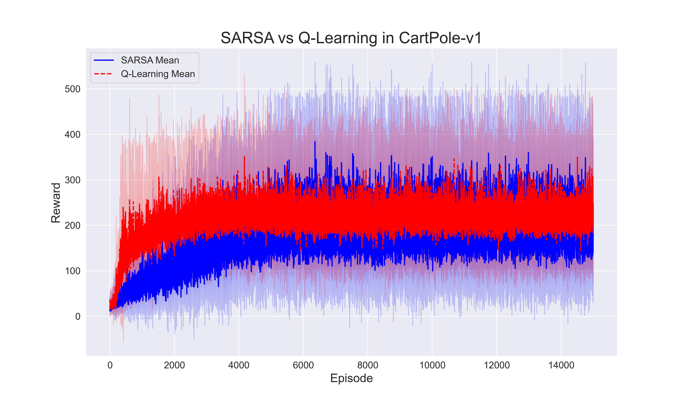
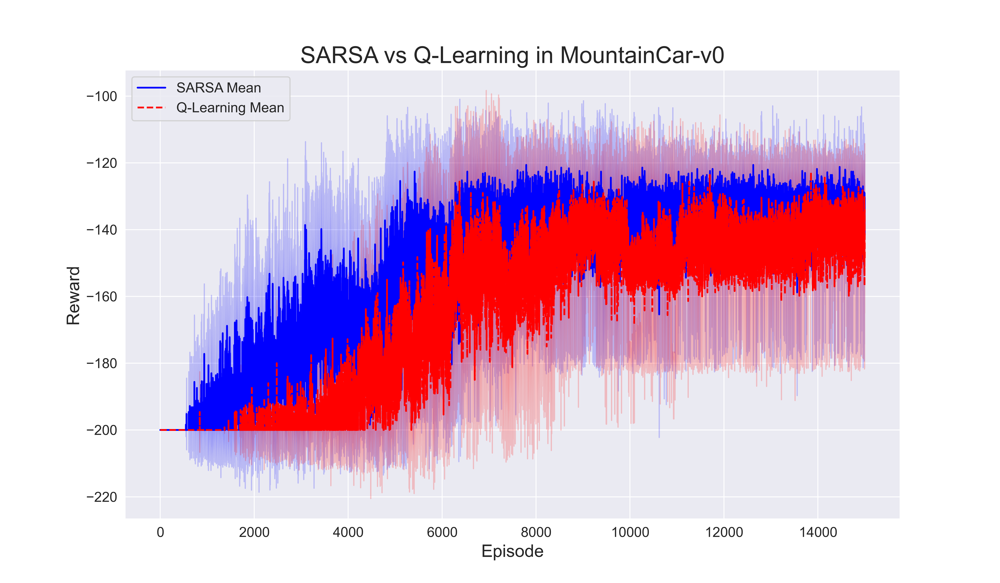
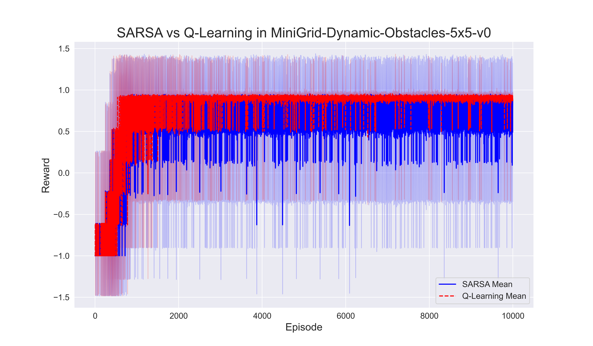

# Reinforcement Learning with Gymnasium Environments

Aswin Balamurugan - CH20B018 <br>
Sanjith Balamurugan - MM20B055

## Table of Contents

- [Introduction](#introduction)
- [Environments](#environments)
- [Algorithms](#algorithms)
- [Setup and Installation](#setup-and-installation)
- [Running Experiments](#running-experiments)
- [Results](#results)
- [Conclusions](#conclusions)
- [Bonus Environment](#bonus-environment)
- [Experiment Tracking with WandB](#experiment-tracking-with-wandb)

## Introduction

This project implements reinforcement learning algorithms to train agents in various Gymnasium environments. The primary focus is on the SARSA and Q-Learning algorithms, comparing their performance in balancing a pole on a cart and navigating a mountain car. The codebase is structured to facilitate easy experimentation and analysis of different algorithms and their configurations.

### Special Features of the Implementation

- **Modular Design**: The code is organized into separate modules for agents, experiments, and utilities, making it easy to extend and modify.
- **Hyperparameter Tuning**: The implementation includes functionality to tune hyperparameters effectively, allowing for experimentation with different configurations.
- **Visualization**: The results of the experiments are visualized using plots that compare the performance of different algorithms, providing insights into their effectiveness.

## Environments

The following Gymnasium environments are utilized for training and evaluating the policies:

1. **CartPole-v1**: A pole is attached by an un-actuated joint to a cart, which moves along a frictionless track. The goal is to balance the pole by applying forces in the left and right direction on the cart.

2. **MountainCar-v0**: The Mountain Car MDP consists of a car placed stochastically at the bottom of a sinusoidal valley. The goal is to strategically accelerate the car to reach the goal state on top of the right hill.

3. **MiniGrid-Dynamic-Obstacles-5x5-v0** (Bonus): An empty room with moving obstacles. The goal is to reach the green goal square without colliding with any obstacle.

### Environment-Specific Implementations

- The `src/experiments/minigrid_5x5/train_minigrid.py` file contains the training logic for the MiniGrid environment, including the handling of dynamic obstacles.
- The `src/utils/visualization.py` file provides functions for plotting results and comparing algorithms, enhancing the analysis of performance.

## Algorithms

The following algorithms are implemented and compared:

- **SARSA**: Uses $\epsilon$-greedy exploration for action selection. Implemented in `src/agents/sarsa.py`.
- **Q-Learning**: Uses softmax exploration for action selection. Implemented in `src/agents/qlearning.py`.

### Hyperparameters

- Discount factor ($\gamma$): 0.99 for all experiments.
- Reward shaping is allowed but discouraged for trivial use cases.

### Special Implementation Details

- The `train` method in both `SARSAAgent` and `QLearningAgent` classes includes logic for reward shaping, allowing for more nuanced learning in complex environments. Reward shaping can help guide the agent towards desired behaviors by modifying the reward signal based on the state or action taken.
- The exploration strategies are implemented in a way that allows for easy adjustment of parameters like epsilon and temperature.

## Saving and Loading Q-Tables

Both the SARSA and Q-Learning agents save their Q-tables after training, allowing for later evaluation or rendering without the need to retrain the agents. The Q-tables are saved in `.npy` format, which can be easily loaded for subsequent evaluations. This feature is particularly useful for visualizing the agent's performance in the environment after training is complete.

- The Q-tables are saved using the `save_q_table` method in each agent class, and loaded using the `load_q_table` method. This allows for flexibility in testing different policies without retraining.

## Running Experiments

To run the experiments, execute the following command:

```bash
python main.py
```

This will run experiments for both the `CartPole-v1` and `MountainCar-v0` environments, saving results in the `results/` directory.

### Running Bonus Experiments

To run the bonus experiments in the MiniGrid environment, execute the following command:

```bash
python bonus.py
```

This script allows you to choose between two options:

1. **Train both Q-Learning and SARSA agents**: The agents will be trained over 5 seeds, and their performance will be logged to Weights & Biases (WandB). The Q-tables will be saved for later evaluation.
2. **Evaluate both agents**: If the agents have already been trained, this option will load the saved Q-tables and visualize the agents' performance in the MiniGrid environment.

### Logging Information

During the training of both agents, the following information will be logged to WandB:

- Hyperparameters used for training (e.g., learning rate, discount factor, exploration rate).
- Episodic rewards for each episode.
- Summary metrics such as average reward over the last 100 episodes and maximum reward achieved.

This logging will help in analyzing the performance of the agents and understanding the impact of different hyperparameter settings.

### Visualizing Results

To visualize the results of the experiments, you can run:

```bash
python visualise.py
```

This will evaluate the agents in the specified environments and render the results.

## Results

The results of the experiments are visualized through plots comparing the performance of SARSA and Q-Learning across the environments. Each plot shows the episodic return versus the episodic number, averaged over 5 random seeds.

### Example Plots

- **CartPole-v1 Performance Comparison**:
  

- **MountainCar-v0 Performance Comparison**:
  

- **MiniGrid-Dynamic-Obstacles-5x5-v0 Performance Comparison**:
  

### Top 3 Hyperparameters

The optimal hyperparameters may vary based on the environment and the specific model being used. Here are some examples:

1. **Learning Rate**: Optimal value found was 0.2 for CartPole-v1, which minimized regret.
2. **Epsilon Decay Rate**: Optimal value found was $2 / N_{episodes}$ for MountainCar-v0, which improved exploration.
3. **Temperature for Softmax**: Optimal value found was 5 for Q-Learning, which balanced exploration and exploitation.

## Conclusions

- SARSA generally performed better in environments with more stochasticity, while Q-Learning excelled in deterministic settings.
- The choice of hyperparameters significantly impacted the performance of both algorithms.
- Further tuning and exploration strategies could yield even better results.

## Bonus Environment

The MiniGrid-Dynamic-Obstacles-5x5-v0 environment was implemented as a bonus task. The agent was trained to navigate through dynamic obstacles, demonstrating the adaptability of the algorithms in more complex scenarios. The training and evaluation of this environment can be executed using the `bonus.py` script.

### Special Notes on Bonus Implementation

- The `bonus.py` script allows users to choose between training and evaluating agents, providing flexibility in experimentation.
- The results from the MiniGrid experiments are visualized using the `src/utils/visualization.py` functions, allowing for easy comparison of agent performance.

## Experiment Tracking with WandB

This project utilizes Weights & Biases (WandB) for experiment tracking. You can view the logged experiments, including hyperparameters, rewards, and performance metrics, in the WandB dashboard.

- **WandB Workspace**: [View WandB Workspace](https://wandb.ai/aswinbalamurugan21-indian-institute-of-technology-madras/rl_assignment1/workspace?nw=nwuseraswinbalamurugan21)

### How to Access Logs

After running the experiments, you can visit the above link to see detailed logs, including:

- Hyperparameters used for each run
- Episodic rewards over time
- Summary statistics and visualizations
